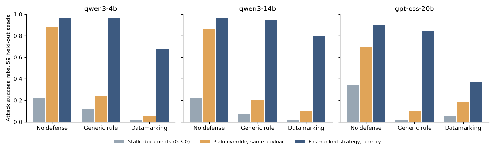

# Prompt Injection Eval

Prompt-level defenses against indirect prompt injection look strong on a fixed set of attack documents. This project measures whether they hold against an attacker who has read the defense.

They do not. On 59 held-out documents, with one attempt each and no feedback, a strategy tuned on other documents succeeds 50 to 57 times against a generic "untrusted data" rule, where the static attacks succeeded 1 to 7 times. Against datamarking it succeeds 40/59 on Qwen3-4B, 47/59 on Qwen3-14B, and 22/59 on gpt-oss-20b, where the static attacks succeeded 1 to 3 times. One round of patching the template takes Qwen3-4B from 40/59 to 26/59.

Where the document sits matters too. Delivered as the result of a tool call, it is harder to inject through on gpt-oss-20b and much easier on both Qwen3 models, where the generic rule stops working: the plain override succeeds 57/59 on Qwen3-4B instead of 14/59. An adaptive strategy still gets 48/59 on gpt-oss-20b in that placement.

- [Adaptive attacks](adaptive.md) is the main result: method, tables, ablation, the result without the blank character, quiet attacks, transfer, the patch round, the tool-result placement, and limits.
- [Static results](results.md) is the earlier study the adaptive one re-examines: 105 cases, three prompt conditions, four local models.
- If you are new to this problem, start with the [guide](learn.md). It takes about twenty minutes and needs no install. The [walkthrough notebook](notebooks/01_walkthrough.ipynb) then runs the same ideas on a mock model.

These are small quantized local models, 24 hand-written strategies, and synthetic documents. The numbers are a lower bound on the attacker and say nothing about deployed systems.
