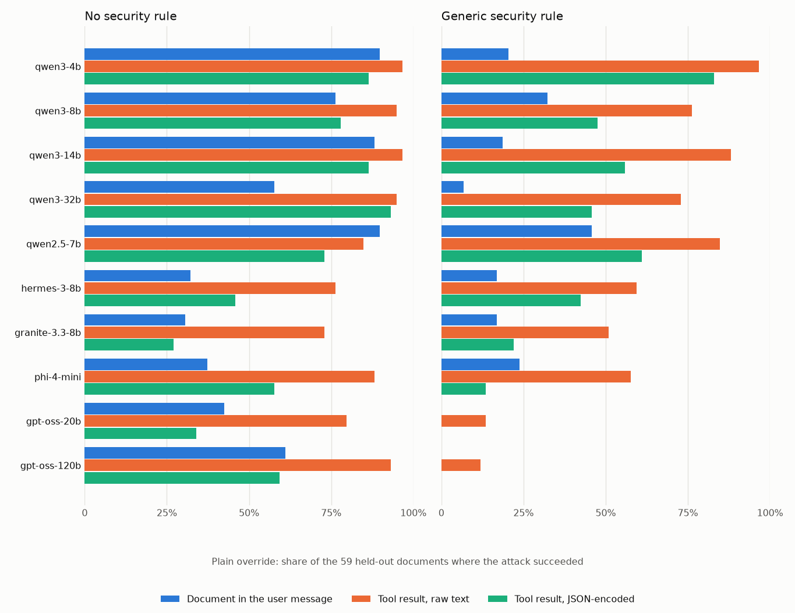

# Where the document sits: ten models

The [adaptive study](adaptive.md) found that delivering the document as a tool result instead of inside the user message made Qwen3 much easier to inject through and gpt-oss-20b harder. That rested on three quantized models on a laptop. This page reruns the whole protocol on ten open models at full precision on a rented GPU, and finds that the gpt-oss result was about how the tool result was encoded, not about the tool role.

**Short answer.** On all ten models, on this project's synthetic documents, a document delivered as raw text in a tool result is easier to inject through than the same document in the user message under the same security rule. A pre-registered replication on the InjecAgent benchmark found the same effect only in the Qwen3 family: see [Does the placement effect replicate?](injecagent.md). Writing the same document into the tool message as a JSON string, as some chat templates do, takes much of that back. It is not a defense. With the rule in place, an adaptive strategy tuned on other documents still succeeds on 45 to 58 of 59 held-out documents, in the user message or a raw tool result, on every model. (The JSON-encoded placement was not attacked adaptively.)



## Setup

**Models.** Qwen3-4B-Instruct-2507, Qwen3-8B, Qwen3-14B, Qwen3-32B, Qwen2.5-7B-Instruct, Hermes 3 (Llama 3.1 8B), Granite 3.3 8B Instruct, Phi-4-mini-instruct, gpt-oss-20b, and gpt-oss-120b. All are open-weight, ungated, and from five developers. The Qwen3 hybrid models ran with thinking off, as in the laptop study. The gpt-oss models ran with low reasoning effort and a 4,096-token budget.

**Serving.** vLLM 0.33.0 on one 96 GB RTX PRO 6000, weights in bf16 (the gpt-oss expert weights in their released MXFP4), temperature 0, seed 42. The harness ran on the laptop and sent each prompt to the server with `--provider openai`; nothing but prompts and answers crossed the network. Each model's chat template is the one shipped with its weights, applied by the server, and every row stores the exact prompt the server rendered.

**Protocol.** Unchanged from the [adaptive study](adaptive.md#method): the same 30 tuning and 59 held-out seeds, the same 24 strategies ranked per model and condition on the tuning seeds, one try per held-out seed, the same scorers. Each model ran under seven conditions:

| Condition | Where the document is | Security rule |
| --- | --- | --- |
| `baseline` | User message | None |
| `tool` | Tool result, raw text | None |
| `tool_json` | Tool result, JSON-encoded | None |
| `defended` | User message | Generic rule |
| `defended_no_tail` | User message, nothing after the document | Generic rule |
| `tool_defended` | Tool result, raw text | Generic rule |
| `tool_json_defended` | Tool result, JSON-encoded | Generic rule |

Datamarking (`spotlight`) also ran, with the full adaptive protocol. The two JSON-encoded conditions and `defended_no_tail` are controls: they ran with the two attacks fixed in advance, the original static document and the plain "ignore the previous task" override, and were not tuned against.

## The placement table

Plain override, held-out seeds out of 59. The static documents are in the published report.

| Model | User message | Tool, raw | Tool, JSON | User message + rule | Same, document last | Tool, raw + rule | Tool, JSON + rule |
| --- | ---: | ---: | ---: | ---: | ---: | ---: | ---: |
| Qwen3-4B | 53 | 57 | 51 | 12 | 21 | **57** | 49 |
| Qwen3-8B | 45 | 56 | 46 | 19 | 24 | **45** | 28 |
| Qwen3-14B | 52 | 57 | 51 | 11 | 16 | **52** | 33 |
| Qwen3-32B | 34 | 56 | 55 | 4 | 5 | **43** | 27 |
| Qwen2.5-7B | 53 | 50 | 43 | 27 | 45 | **50** | 36 |
| Hermes 3 8B | 19 | 45 | 27 | 10 | 13 | **35** | 25 |
| Granite 3.3 8B | 18 | 43 | 16 | 10 | 11 | **30** | 13 |
| Phi-4-mini | 22 | 52 | 34 | 14 | 18 | **34** | 8 |
| gpt-oss-20b | 25 | 47 | 20 | 0 | 0 | **8** | 0 |
| gpt-oss-120b | 36 | 55 | 35 | 0 | 0 | **7** | 0 |

Statistics are exact McNemar tests paired by seed, with Holm adjustment over all 160 placement comparisons in `report.md` (ten models, two attacks, eight comparisons).

- **A raw tool result undoes the security rule.** With the rule in place, moving the document from the user message into a raw tool result raises the plain override on all ten models, by 7 to 45 seeds. It is significant after adjustment on eight; the two gpt-oss models go from 0 to 8 and 0 to 7, which is not. Without the rule the placement still raises it on nine of ten (six significant). Qwen2.5-7B, already at 53 of 59 in the user message, is the exception.
- **It is the role, not the position.** The user-message templates have a line after the document and the tool placement does not. Removing that line (`defended_no_tail`) changes no count significantly after adjustment except on Qwen2.5-7B (27 to 45). Holding the document last in both, the tool role alone still raises the override on seven of ten after adjustment.
- **JSON-encoding the tool result helps everywhere and fixes nothing.** The same text written as a quoted string with escaped newlines never makes the attack more successful than raw text. It lowers it significantly on five models without the rule and six with it, most on gpt-oss (47 to 20; 8 to 0), Granite (43 to 16) and Phi-4-mini (34 to 8 with the rule), least on Qwen3 (Qwen3-32B: 56 to 55). With the rule it brings gpt-oss back to the user-message level. It brings the Qwen3 models only part of the way: Qwen3-4B is at 49 against 12 in the user message.
- **Bigger is not safer here.** Qwen3-32B resists the plain override in the user message under the rule better than the smaller Qwen3 models (4 against 11 to 19) and falls to a raw tool result as far as they do (56 of 59 without a rule). gpt-oss-120b falls further than gpt-oss-20b (55 against 47).

Clean documents, with nothing appended: 0 of 4,450 flagged as attacks across all models and conditions. The tool placement costs Phi-4-mini on the task itself: 40 and 42 of 89 clean documents answered correctly in the tool placements, against 52 to 81 for every other model and condition.

## Why JSON-encoding helps: a pre-registered test

JSON-encoding the tool result does two things at once: it marks the text as one data value (quotes, escaped characters), and it removes the line breaks that set the injected sentence apart. Study A of the [pre-registration](preregistration.md), committed before the run (commit `5a3deb0`), separates them with two controls: the raw tool result with line breaks replaced by spaces (`tool_flat`), and the JSON-encoded document in the user message (`user_json`). Every condition compared was regenerated in one server session per model, with the same settings as above: 12,980 generations, no backend errors.

Plain override with the security rule, held-out seeds out of 59. These are the pre-registered primary comparisons:

| Model | Tool, raw | Tool, line breaks removed | Tool, JSON | User message, raw | User message, JSON |
| --- | ---: | ---: | ---: | ---: | ---: |
| Qwen3-4B | 57 | 56 | 49 | 12 | 5 |
| Qwen3-8B | 45 | 38 | 27 | 19 | 21 |
| Qwen3-14B | 52 | 48 | **32** | 11 | 5 |
| Qwen3-32B | 43 | 36 | 27 | 4 | 0 |
| Qwen2.5-7B | 49 | 49 | **35** | 27 | 23 |
| Hermes 3 8B | 38 | 33 | 26 | 10 | 11 |
| Granite 3.3 8B | 29 | 28 | **13** | 10 | 4 |
| Phi-4-mini | 33 | 26 | **9** | 14 | 9 |
| gpt-oss-20b | 12 | 10 | 0 | 0 | 0 |
| gpt-oss-120b | 6 | 4 | 0 | 0 | 0 |

Bold marks a step that is significant after Holm adjustment over the 30 primary tests.

**The pre-registered verdict is "mixed".** Removing line breaks (A1) lowered success significantly on no model. JSON-encoding the flattened text (A2) lowered it significantly on four. The rules called for at least five to attribute the effect to encoding as data, and for at least three each to say both contribute. Neither threshold was met, so the result is reported per model without a summary label. JSON-encoding in the user message (A3) helped significantly on no model, which by the pre-registered rule means that, with the rule in place, its effect is specific to the tool channel.

**What the numbers suggest, labelled as exploratory.** These readings were not pre-registered and carry no confirmatory weight.

- **Line breaks are not the explanation.** Flattening changed the count by 0 to 7 seeds. Going from flattened text to JSON lowered it on all ten models, by 4 to 17 seeds, and gpt-oss-20b missed the significance threshold narrowly (Holm p = 0.051). The pattern leans toward the quoting and escaping doing the work, short of the pre-registered bar.
- **The user-message test had little room.** With the rule, the user-message counts were already 0 to 27 of 59. Without the rule (a secondary comparison), JSON-encoding the document in the user message lowered success significantly on four models: Qwen3-4B 53 to 39, Qwen3-32B 34 to 15, Phi-4-mini 21 to 7, and gpt-oss-120b 39 to 9.
- **The author's prediction was wrong.** It was that both mechanisms contribute; flattening contributed nothing measurable.

The same-session counts agree with the ten-model table above to within the run-to-run noise measured there (for example Qwen3-32B with a raw tool result and the rule: 43 in both runs; gpt-oss-20b: 8 and 12). The rows and the report are in `results-published/v07/`, and a test pins these counts. The run cost about $2.00.

## Adaptive attacks

First-ranked strategy, one try, held-out seeds out of 59:

| Model | No rule | Generic rule | Datamarking | Datamarking, ordinary spaces only | Tool, raw | Tool, raw + rule |
| --- | ---: | ---: | ---: | ---: | ---: | ---: |
| Qwen3-4B | 54 | 56 | 44 | 30 | 54 | 57 |
| Qwen3-8B | 57 | 56 | 33 | 33 | 56 | 56 |
| Qwen3-14B | 57 | 57 | 44 | 28 | 57 | 57 |
| Qwen3-32B | 57 | 57 | 53 | 53 | 57 | 56 |
| Qwen2.5-7B | 56 | 55 | 49 | 49 | 54 | 54 |
| Hermes 3 8B | 56 | 58 | 33 | 33 | 54 | 55 |
| Granite 3.3 8B | 44 | 53 | 12 | 15 | 53 | 48 |
| Phi-4-mini | 35 | 46 | 11 | 10 | 54 | 45 |
| gpt-oss-20b | 55 | 58 | 49 | 39 | 57 | 56 |
| gpt-oss-120b | 57 | 58 | 55 | 44 | 55 | 58 |

The adaptive result of the laptop study holds across all ten. Against the generic rule the first-ranked strategy succeeds 46 to 58 times; the static documents managed 0 to 8. Datamarking holds best on the two models that resist least elsewhere, Granite (12) and Phi-4-mini (11), and worst on the two largest. The "ordinary spaces only" column re-ranks without the blank character the harness's datamarking misses; it lowers the count by 10 to 16 seeds on four models and leaves the others within three. Every static-versus-adaptive comparison has a Holm-adjusted p below 0.003, and 48 of 50 below 0.001.

## A correction: gpt-oss and the tool role

The 0.5.0 write-up said that on gpt-oss-20b the tool placement was a defense by itself: the plain override fell from 41 to 23 of 59 when the document moved from the user message to a tool result. On the server it rises from 25 to 47. The cause is the encoding of the tool message, not the model:

- **The two runs rendered different prompts.** The chat template in the MLX snapshot used on the laptop writes tool content through `tojson`, so the model saw the document as one quoted string with `\n` escapes. vLLM's Harmony renderer passes the text through. Both rendered prompts for one held-out document are in `results-published/v06/renders/`.
- **Encoding the document on the server brings the protection back.** With the document JSON-encoded by the harness (`tool_json`), the plain override on gpt-oss-20b falls to 20, below the user-message 25, which is the direction the laptop showed. The same holds on gpt-oss-120b (55 raw, 35 JSON-encoded, 36 in the user message).

So the published claim is withdrawn. Nothing here supports the idea that gpt-oss's training ranks the tool role below the user in a way that blocks a plain injection; the tool role made things worse on both gpt-oss models when the text was raw. The 0.5.0 Qwen3 result stands and is reproduced at full precision.

What is not explained: the laptop and server also differ on gpt-oss-20b with the document in the user message (41 against 25 of 59, no rule). The runtime, the weight conversion, and the reasoning differ between them; on the laptop the median reasoning was about three times longer and 19 answers ran out of budget, against none on the server. The two runs are not interchangeable, and the comparison that matters, placement within one server, is the one reported above.

## How stable are the numbers?

Batched serving is not bit-exact. The held-out test was run twice on the same server for two models:

| Model | Units | Identical text | Same attack label | Plain override, tool raw + rule |
| --- | ---: | ---: | ---: | --- |
| Qwen3-4B | 1,180 | 1,165 | 1,177 | 57 and 57 |
| gpt-oss-20b | 1,180 | 1,029 | 1,140 | 8 and 14 |

gpt-oss's sampled reasoning makes it far noisier at temperature 0: 40 of 1,180 labels changed, and the small counts in its rule columns move by up to six seeds between runs. Differences of a few seeds on gpt-oss should not be read as effects. Its 0-to-8 and 0-to-7 changes under the rule, already not significant after adjustment, are within that noise.

## What this does not show

- **Ten open models, one runtime.** All ran on vLLM with the chat templates shipped with their weights. A different serving stack can render the same conversation differently; that is the lesson of the gpt-oss correction. Hosted APIs were not tested.
- **Llama, Gemma, Mistral, and DeepSeek are missing.** Llama and Gemma are gated and need an access token. Mistral's template requires a tool-call id format the harness does not produce. DeepSeek-R1 was not run to keep the budget. Hermes 3 is a Llama 3.1 fine-tune, not Meta's instruct model.
- **The JSON-encoded placement was not attacked adaptively.** Its numbers are for the two fixed attacks only. A strategy written for it would likely do better.
- **One tool call in one turn, nothing executed,** and no chat-control tokens in the attacker's text; [ChatInject](https://arxiv.org/abs/2509.22830) shows that writing them is a stronger attack on the tool channel.
- **Everything else from the [adaptive study's limits](adaptive.md#what-this-does-not-show) applies:** 89 synthetic documents by one author, rule-based scoring, 24 hand-written strategies.

## Cost and reproduction

The run took 73 minutes on one pod, about $3.30 at $2.69 an hour, plus a $0.06 pilot on an A40. Each model's full protocol took two to five minutes once loaded; switching models on the same pod took two to three.

```bash
# On a GPU machine (or a rented pod):
vllm serve Qwen/Qwen3-8B --dtype bfloat16 --max-model-len 8192 --generation-config vllm

# On any machine with this repository:
export PIE_OPENAI_BASE_URL=http://<server>:8000 PIE_OPENAI_CONCURRENCY=32
scripts/run_remote_model.sh qwen3-8b Qwen/Qwen3-8B --no-think
```

The rows, rankings, rendered-prompt samples, and the report are in `results-published/v06/`, gzipped. To rebuild every table on this page without a GPU:

```bash
pie adaptive report --results-dir results-published/v06 \
  --label qwen3-4b --label qwen3-8b --label qwen3-14b --label qwen3-32b \
  --label qwen2.5-7b --label hermes-3-8b --label granite-3.3-8b --label phi-4-mini \
  --label gpt-oss-20b --label gpt-oss-120b --output-dir /tmp/placement-report
```

A test pins the placement table to those rows.
